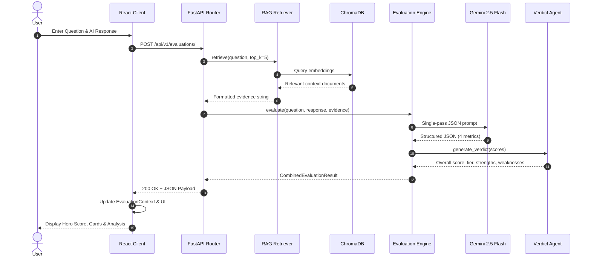
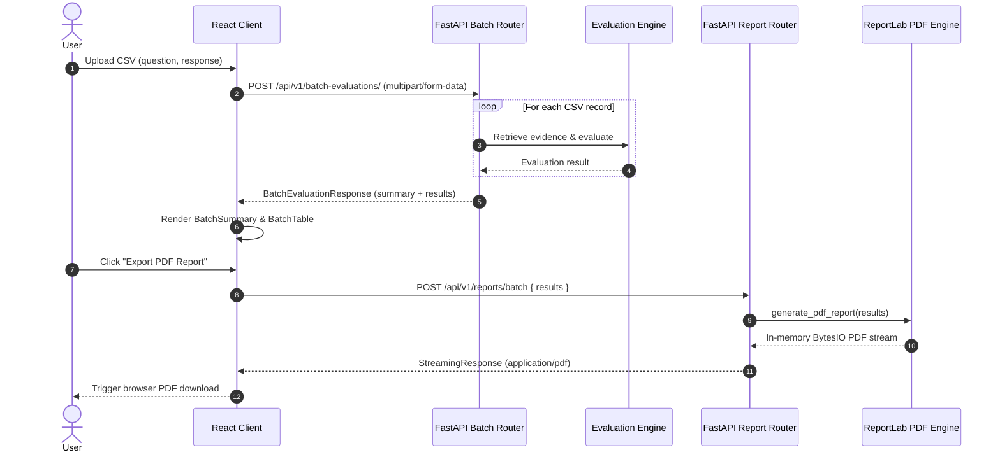

# AI Response Evaluator (AIRE)

[](LICENSE)
[](https://fastapi.tiangolo.com)
[](https://react.dev)
[](https://deepmind.google/technologies/gemini/)
[](https://www.trychroma.com/)
[-brightgreen.svg)](testing/test_cases.md)

An intelligent, enterprise-grade evaluation platform designed to benchmark, audit, and explain the quality of Large Language Model (LLM) responses using Retrieval-Augmented Generation (RAG), multi-agent judging, granular claim-level hallucination detection, interactive analytics, and automated PDF report generation.

---

## Table of Contents

- [Overview](#overview)
- [Key Features](#key-features)
- [System Architecture](#system-architecture)
- [Evaluation Dimensions & Rubric](#evaluation-dimensions--rubric)
- [Knowledge Base & RAG Pipeline](#knowledge-base--rag-pipeline)
- [Application Flow & Sequence](#application-flow--sequence)
- [API Reference](#api-reference)
- [Repository Structure](#repository-structure)
- [Tech Stack](#tech-stack)
- [Getting Started](#getting-started)
  - [Prerequisites](#prerequisites)
  - [Backend Setup](#backend-setup)
  - [Frontend Setup](#frontend-setup)
  - [Building the Knowledge Base](#building-the-knowledge-base)
- [Testing & Quality Assurance](#testing--quality-assurance)
- [Roadmap & Future Enhancements](#roadmap--future-enhancements)
- [Author & License](#author--license)

---

## Overview

Large Language Models (LLMs) like GPT-4, Claude, Gemini, and Llama are increasingly deployed in mission-critical applications. However, LLMs can produce responses that are:
- **Factually inaccurate** or untethered from reference sources.
- **Hallucinated**, presenting fabricated facts with high confidence.
- **Incomplete**, missing essential context or answering only partially.
- **Irrelevant**, drifting from the user's specific prompt.

Manual review is subjective, expensive, and difficult to scale. Traditional reference-based NLP metrics like BLEU or ROUGE only measure n-gram overlap and fail to capture semantic meaning or nuanced hallucinations.

**AI Response Evaluator (AIRE)** bridges this gap by providing an automated, explainable, and multi-dimensional evaluation engine. AIRE leverages RAG retrieval over curated ground truth (SQuAD) and an optimized multi-agent LLM judge (Gemini 2.5 Flash) to score responses across four foundational axes, detect claim-level hallucinations, synthesize actionable verdicts, and produce exportable executive reports.

---

## Key Features

- **Single Response Evaluation**:
  - Interactive web interface to submit a question and AI response.
  - Automatic semantic evidence retrieval from the knowledge base.
  - Real-time scoring across Relevance, Accuracy, Completeness, and Hallucination.
  - Detailed accordion views for each agent's reasoning, supporting evidence citations, and aspect-level completeness checks.

- **Batch Evaluation via CSV**:
  - Bulk evaluation of test sets by uploading CSV files (`question,response`).
  - Asynchronous row-by-row retrieval, evaluation, and score aggregation.
  - Interactive data table with sorting, filtering, and deep-dive inspection modals.
  - Automatic synchronization of batch results to the global evaluation context.

- **Granular Claim-Level Hallucination Attribution**:
  - Deconstructs responses into atomic factual statements.
  - Independently validates each claim against retrieved ground truth evidence.
  - Categorizes claims into `Supported` vs. `Hallucinated / Unsupported` with explicit rationales.

- **Unified Verdict & Actionable Recommendations**:
  - Synthesizes dimension scores into an overall quality score (0–10).
  - Categorizes responses into quality tiers: `Excellent`, `Very Good`, `Good`, `Fair`, and `Poor`.
  - Automatically identifies key strengths, flagged weaknesses, and concrete recommendations.

- **Interactive Analytics Dashboard**:
  - High-level KPIs: Total Evaluations, Pass/Review/Fail counts, Average Scores, and Hallucination Frequency.
  - Visual charts: Dimension-wise Average Score Chart, Verdict Distribution Pie Chart, and Quality Trend Line Chart.
  - Real-time search and verdict filter controls with persistent evaluation history.

- **Exportable PDF Quality Reports**:
  - One-click server-side PDF generation powered by ReportLab.
  - Branded executive summaries, score distribution tables, hallucination rate analytics, and full audit logs with recommendations.

---

## System Architecture

AIRE is built on a clean decoupled architecture featuring a modern React SPA frontend, a high-throughput FastAPI backend, a persistent ChromaDB vector store for RAG, and Google's Gemini 2.5 Flash as the evaluator model.

```
                              ┌─────────────────────────────────────────┐
                              │          React + Vite + TS UI           │
                              │  (Evaluate / Batch / Dashboard Pages)   │
                              └────────────────────┬────────────────────┘
                                                   │ HTTP / REST (Axios/Fetch)
                                                   ▼
                              ┌─────────────────────────────────────────┐
                              │          FastAPI Backend API            │
                              │         (CORS, Routing, Pydantic)       │
                              └───────┬──────────────┬──────────────┬───┘
                                      │              │              │
                     ┌────────────────┘              │              └────────────────┐
                     ▼                               ▼                               ▼
       ┌──────────────────────────┐    ┌──────────────────────────┐    ┌──────────────────────────┐
       │     /evaluations         │    │   /batch-evaluations     │    │       /reports/batch     │
       │ (Single Evaluation Flow) │    │  (CSV Reader & Batching) │    │ (ReportLab PDF Generator)│
       └─────────────┬────────────┘    └─────────────┬────────────┘    └──────────────────────────┘
                     │                               │
                     └────────────────┬──────────────┘
                                      │
                                      ▼
                       ┌──────────────────────────────┐
                       │       RAG Retriever          │
                       │ (SentenceTransformer MiniLM) │
                       └──────────────┬───────────────┘
                                      │ Top-K Semantic Search
                                      ▼
                       ┌──────────────────────────────┐
                       │     ChromaDB Vector Store    │
                       │   (Persistent SQuAD Chunks)  │
                       └──────────────┬───────────────┘
                                      │ Retrieved Evidence Context
                                      ▼
                       ┌──────────────────────────────┐
                       │   Evaluation Engine Core     │
                       └──────────────┬───────────────┘
                                      │
                                      ▼
                       ┌──────────────────────────────┐
                       │    CombinedJudgeAgent        │
                       │  (Single-Pass Structured     │
                       │   Gemini 2.5 Flash Prompt)   │
                       └──────────────┬───────────────┘
                                      │ JSON (Relevance, Accuracy,
                                      │       Hallucination, Completeness)
                                      ▼
                       ┌──────────────────────────────┐
                       │        VerdictAgent          │
                       │ (Overall Score, Verdict tier,│
                       │  Strengths, Weaknesses, Recs)│
                       └──────────────┬───────────────┘
                                      │
                                      ▼
                       ┌──────────────────────────────┐
                       │ CombinedEvaluationResult DTO │
                       └──────────────────────────────┘
```

### Architectural Highlights

1. **Single-Pass LLM Judge Optimization**:
   Early implementations executed separate LLM calls for each evaluator agent (Relevance, Accuracy, Hallucination, Completeness), resulting in high latency, increased API cost, and inter-call latency variance. The current architecture employs `CombinedJudgeAgent`, executing a unified, strictly constrained JSON schema prompt against `gemini-2.5-flash` in a single pass, slashing latency by ~70% while improving evaluation coherence.

2. **RAG-Grounded Reference Context**:
   Evaluations are not left to open-ended LLM heuristics. Queries are embedded via `sentence-transformers/all-MiniLM-L6-v2` and matched against a persistent ChromaDB vector store pre-indexed with domain knowledge (SQuAD dataset contexts), providing concrete evidence documents for factual verification.

---

## Evaluation Dimensions & Rubric

Each response is evaluated on four independent metrics scored on a normalized scale from **0.0 to 10.0**, followed by an overall verdict synthesis:

| Dimension | Scale | Meaning & Criteria | Primary Output Fields |
|---|:---:|---|---|
| **Relevance** | 0 – 10 | Measures how directly and appropriately the response addresses the prompt without extraneous digression. | `score`, `label`, `confidence`, `reason` |
| **Accuracy** | 0 – 10 | Measures factual truthfulness strictly verified against retrieved ground truth evidence. | `score`, `confidence`, `supporting_evidence`, `reason` |
| **Hallucination** | 0 – 10 | Inverted scale where **10 = zero hallucination** and **0 = severe hallucination**. Isolates factual claims and flags unverified assertions. | `score`, `confidence`, `hallucinated_claims[]`, `supported_claims[]`, `reason` |
| **Completeness** | 0 – 10 | Assesses whether all critical aspects and sub-questions expected from the reference context are covered. | `score`, `confidence`, `covered_aspects[]`, `missing_aspects[]`, `reason` |
| **Overall Verdict** | 0 – 10 | Unweighted mean of the 4 dimensions: $\frac{\text{Rel} + \text{Acc} + \text{Hal} + \text{Comp}}{4}$. | `overall_score`, `verdict`, `strengths[]`, `weaknesses[]`, `recommendation` |

### Verdict Categorization & Recommendation Tiers

- **9.0 – 10.0 (`Excellent` / `Pass`)**: Highly reliable; response can be deployed or used with complete confidence.
- **8.0 – 8.9 (`Very Good` / `Pass`)**: Reliable with only minor stylistic or non-critical omissions.
- **7.0 – 7.9 (`Good`)**: Acceptable quality; suitable for general use with minor improvements recommended.
- **5.0 – 6.9 (`Fair` / `Needs Improvement`)**: Requires manual review and factual revision before presentation.
- **0.0 – 4.9 (`Poor` / `Fail`)**: Contains significant hallucinations, major inaccuracies, or fails to answer the question; must be regenerated.

---

## Knowledge Base & RAG Pipeline

The RAG knowledge base provides an objective ground truth for question answering and evaluation:

```
┌──────────────────┐     ┌──────────────────┐     ┌──────────────────┐
│  SQuAD Dataset   │ ──> │ TextPreprocessor │ ──> │ AdaptiveChunker  │
│ (HuggingFace API)│     │ (Clean & Normal) │     │ (Tokens/Context) │
└──────────────────┘     └──────────────────┘     └────────┬─────────┘
                                                           │
                                                           ▼
┌──────────────────┐     ┌──────────────────┐     ┌──────────────────┐
│  Query Search    │ <── │ ChromaVectorStore│ <── │    Embedder      │
│ (Cosine Top-K=5) │     │  (chroma.sqlite3)│     │(all-MiniLM-L6-v2)│
└──────────────────┘     └──────────────────┘     └──────────────────┘
```

1. **Ingestion (`DatasetManager`)**: Loads the SQuAD (Stanford Question Answering Dataset) corpus via Hugging Face `datasets` and extracts unique context passages.
2. **Preprocessing (`TextPreprocessor`)**: Sanitizes whitespace, normalizes Unicode, strips formatting anomalies, and prepares text for tokenization.
3. **Adaptive Chunking (`AdaptiveChunker`)**: Splits long context passages into semantically coherent overlapping segments suitable for dense retrieval.
4. **Dense Embeddings (`Embedder`)**: Transforms text chunks into 384-dimensional dense vector embeddings using `all-MiniLM-L6-v2`.
5. **Persistent Vector Store (`ChromaVectorStore`)**: Stores vector embeddings and document metadata in `./chroma_db` for sub-second retrieval.
6. **Retriever (`Retriever`)**: Embeds incoming questions and executes top-$k$ nearest neighbor search ($k=5$) to inject ground-truth evidence into the evaluation prompt.

---

## Application Flow & Sequence

### 1. Single Evaluation Flow



### 2. Batch Evaluation & Report Flow



---

## API Reference

### 1. Single Evaluation
- **Endpoint**: `POST /api/v1/evaluations/`
- **Description**: Evaluates a single AI response against ground-truth evidence.
- **Request Body**:
  ```json
  {
    "question": "What is the capital of France?",
    "response": "The capital of France is Paris, known for the Eiffel Tower.",
    "evidence": "Optional manual reference string. If omitted, RAG retriever automatically fetches evidence."
  }
  ```
- **Response** (`200 OK`):
  ```json
  {
    "relevance": {
      "score": 10.0,
      "label": "Highly Relevant",
      "confidence": 0.98,
      "reason": "Directly answers the query regarding the capital of France."
    },
    "accuracy": {
      "score": 10.0,
      "confidence": 0.99,
      "supporting_evidence": ["Paris is the capital and most populous city of France."],
      "reason": "Accurately identifies Paris as the capital."
    },
    "hallucination": {
      "score": 10.0,
      "confidence": 0.95,
      "supported_claims": [{ "claim": "The capital of France is Paris." }],
      "hallucinated_claims": [],
      "reason": "All claims are verifiable and factual."
    },
    "completeness": {
      "score": 9.5,
      "confidence": 0.95,
      "covered_aspects": ["Identified capital city"],
      "missing_aspects": [],
      "reason": "Fully addresses the prompt."
    },
    "verdict": {
      "overall_score": 9.88,
      "verdict": "Excellent",
      "strengths": [
        "The response is highly relevant to the user's question.",
        "The response is well supported by the reference evidence.",
        "The response contains little or no hallucinated information."
      ],
      "weaknesses": ["No major weaknesses were identified."],
      "recommendation": "The response is highly reliable and can be used with confidence."
    }
  }
  ```

### 2. Batch Evaluation
- **Endpoint**: `POST /api/v1/batch-evaluations/`
- **Content-Type**: `multipart/form-data`
- **Parameters**: `file` (CSV file with headers `question` and `response`).
- **Response** (`200 OK`):
  ```json
  {
    "summary": {
      "total_evaluations": 10,
      "average_relevance": 8.95,
      "average_accuracy": 8.70,
      "average_hallucination": 8.85,
      "average_completeness": 8.40,
      "average_overall": 8.73
    },
    "results": [
      {
        "question": "...",
        "response": "...",
        "evaluation": { ... }
      }
    ]
  }
  ```

### 3. PDF Report Export
- **Endpoint**: `POST /api/v1/reports/batch`
- **Description**: Generates an A4 evaluation report in PDF format.
- **Request Body**:
  ```json
  {
    "results": [
      {
        "question": "...",
        "response": "...",
        "evaluation": { ... }
      }
    ]
  }
  ```
- **Response** (`200 OK`): Binary stream (`application/pdf`) with `Content-Disposition: attachment; filename="evaluation-report.pdf"`.

### 4. Health Checks
- `GET /`: Returns `{"message": "App is running"}`
- `GET /test`: Returns `"App is running"`

---

## Repository Structure

```
project/
├── .github/
│   └── workflows/
│       └── ci.yml               # GitHub Actions CI workflow
├── app/                         # Frontend application (React + Vite + TypeScript)
│   ├── public/
│   │   ├── favicon.svg          # Application favicon
│   │   └── icons.svg            # SVG sprite icons
│   ├── src/
│   │   ├── assets/              # Static images and icons
│   │   ├── components/          # Reusable UI component library
│   │   │   ├── AgentAccordion.tsx         # Collapsible agent reason viewer
│   │   │   ├── AverageScoreChart.tsx      # Bar chart for dimension averages
│   │   │   ├── BatchDetailsModal.tsx      # Modal for inspecting single batch row
│   │   │   ├── BatchSummary.tsx           # Batch KPI overview cards
│   │   │   ├── BatchTable.tsx             # Paginated/interactive batch result table
│   │   │   ├── ConfidenceBadge.tsx        # Confidence pill indicator
│   │   │   ├── CSVUploader.tsx            # Drag-and-drop CSV upload component
│   │   │   ├── DashboardFilters.tsx       # Search bar and verdict dropdown
│   │   │   ├── DashboardStats.tsx         # Aggregate metrics header
│   │   │   ├── EvidencePanel.tsx          # Retrieved RAG context display
│   │   │   ├── HallucinationAnalytics.tsx # Hallucination breakdown stats
│   │   │   ├── HallucinationPanel.tsx     # Supported vs hallucinated claims panel
│   │   │   ├── HeroSummary.tsx            # Main evaluation banner with score & tier
│   │   │   ├── MetricCard.tsx             # Dimension score card
│   │   │   ├── ProgressBar.tsx            # Visual progress indicators
│   │   │   ├── TrendChart.tsx             # Historical evaluation trend chart
│   │   │   ├── VerdictCard.tsx            # Strengths, weaknesses, recommendation
│   │   │   └── VerdictPieChart.tsx        # Distribution pie chart
│   │   ├── context/
│   │   │   └── EvaluationContext.tsx      # Global React state with localStorage sync
│   │   ├── pages/
│   │   │   ├── Evaluate.tsx               # Single evaluation page ("/")
│   │   │   ├── BatchEvaluate.tsx          # CSV batch evaluation page ("/batchevaluate")
│   │   │   ├── Dashboard.tsx              # Analytics & history dashboard ("/evaluate")
│   │   │   └── Navbar.tsx                 # Global navigation header
│   │   ├── services/
│   │   │   └── api.ts                     # HTTP client (fetch/blob download utilities)
│   │   ├── types/
│   │   │   └── batch.ts                   # TypeScript interfaces for batch responses
│   │   ├── App.tsx                        # Router layout and route definitions
│   │   ├── main.tsx                       # React application entry point
│   │   └── index.css                      # Tailwind CSS root styling
│   ├── package.json                       # Frontend dependencies and scripts
│   ├── tsconfig.json                      # TypeScript compiler configuration
│   └── vite.config.ts                     # Vite build configuration
├── backend/                     # Backend API & Evaluation Engine (FastAPI)
│   ├── app/
│   │   ├── api/
│   │   │   ├── evaluation.py              # Single evaluation route handler
│   │   │   ├── batch_evaluation.py        # CSV batch evaluation route handler
│   │   │   └── report.py                  # PDF export route handler
│   │   ├── engine/
│   │   │   └── evaluation_engine.py       # Engine coordinator
│   │   ├── evaluation/
│   │   │   ├── agents/
│   │   │   │   ├── combined_judge_agent.py# Gemini 2.5 Flash single-pass evaluator
│   │   │   │   ├── verdict_agent.py       # Verdict aggregation & synthesis
│   │   │   │   ├── accuracy_agent.py      # Standalone accuracy evaluator
│   │   │   │   ├── completeness_agent.py  # Standalone completeness evaluator
│   │   │   │   ├── hallucination_agent.py # Standalone hallucination evaluator
│   │   │   │   └── relevance_agent.py     # Standalone relevance evaluator
│   │   │   ├── models/                    # Pydantic data models for evaluation
│   │   │   │   ├── combined_result.py     # Combined result schema
│   │   │   │   ├── accuracy_result.py     # Accuracy schema
│   │   │   │   ├── completeness_result.py # Completeness schema
│   │   │   │   ├── hallucination_result.py# Hallucination claim schema
│   │   │   │   ├── relevance_result.py    # Relevance schema
│   │   │   │   └── verdict_result.py      # Verdict schema
│   │   │   └── prompts/                   # Evaluator prompt templates
│   │   ├── knowledgebase/
│   │   │   ├── datasets/                  # Dataset loaders & inspectors
│   │   │   ├── embeddings/
│   │   │   │   └── embedder.py            # SentenceTransformers wrapper
│   │   │   ├── preprocessing/
│   │   │   │   ├── chunker.py             # Adaptive text chunker
│   │   │   │   └── preprocessor.py        # Text cleaning and normalization
│   │   │   ├── vectorstore/
│   │   │   │   └── chroma_store.py        # Persistent ChromaDB client wrapper
│   │   │   ├── loader.py                  # Knowledge base ingestion runner
│   │   │   ├── pipeline.py                # End-to-end ingestion pipeline
│   │   │   └── retriever.py               # Top-K semantic similarity retriever
│   │   ├── reports/
│   │   │   └── pdf_report.py              # ReportLab PDF generation logic
│   │   ├── schemas/                       # Pydantic request & response schemas
│   │   │   ├── evaluations.py             # Single evaluation schema
│   │   │   ├── batch_result.py            # Batch result schema
│   │   │   ├── batch_response.py          # Batch response schema
│   │   │   └── batch_summary.py           # Batch summary metrics schema
│   │   ├── services/
│   │   │   └── csv_reader.py              # Asynchronous CSV parser
│   │   └── main.py                        # FastAPI application entry point
│   ├── chroma_db/                         # Persistent ChromaDB vector database storage
│   ├── requirements.txt                   # Python package dependencies
│   ├── validate_agents.py                 # Multi-case agent validation script
│   └── test_*.py                          # Component unit tests (accuracy, chroma, chunker, etc.)
├── testing/                     # End-to-end test suites and sample datasets
│   ├── datasets/
│   │   ├── valid_batch.csv                # 10 sample valid Q&A pairs
│   │   ├── invalid_batch.csv              # Malformed rows for error resilience tests
│   │   └── hallucination_test.csv         # Intentionally falsified responses
│   ├── resullts/                          # Captured benchmark evaluation runs
│   └── test_cases.md                      # Complete 15-case verification test plan & audit
├── sample_batch.csv             # Root sample CSV file for batch testing
├── LICENSE                      # MIT Open Source License
└── README.md                    # Project documentation
```

---

## Tech Stack

| Domain | Technologies | Purpose |
|---|---|---|
| **Frontend Framework** | React 18, TypeScript, Vite | Fast SPA user interface with strict type safety |
| **Styling & UI** | Tailwind CSS, Lucide React | Modern dark-mode UI and icon sets |
| **Data Visualization** | Custom SVG Charts / Chart.js | Visual distributions, trends, and dimension breakdowns |
| **Backend Framework** | FastAPI (Python 3.11+), Uvicorn | High-throughput asynchronous REST API |
| **Data Validation** | Pydantic v2 | Schema enforcement, request validation, and serialization |
| **LLM Judge** | Google Gemini 2.5 Flash (`google-genai`) | High-speed, structured JSON evaluation reasoning |
| **Embeddings** | `sentence-transformers` (`all-MiniLM-L6-v2`) | Local 384-dim dense semantic vector embeddings |
| **Vector Database** | ChromaDB (`chromadb`) | Persistent vector database for semantic retrieval |
| **Dataset Source** | Hugging Face `datasets` (SQuAD) | Benchmark reference knowledge base |
| **PDF Generation** | ReportLab | Enterprise-grade dynamic PDF report generation |
| **Testing** | Pytest, Custom Test Runner | Automated unit and 15-point end-to-end validation |

---

## Getting Started

### Prerequisites

- **Python**: version `3.11` or higher
- **Node.js**: version `18.x` or higher (with `npm`)
- **Google Gemini API Key**: Obtain a key from [Google AI Studio](https://aistudio.google.com/)

---

### Backend Setup

1. **Navigate to the backend directory**:
   ```bash
   cd project/backend
   ```

2. **Create and activate a virtual environment**:
   ```bash
   # Windows (PowerShell)
   python -m venv venv
   .\venv\Scripts\Activate.ps1

   # Linux / macOS
   python3 -m venv venv
   source venv/bin/activate
   ```

3. **Install dependencies**:
   ```bash
   pip install -r requirements.txt
   ```

4. **Configure environment variables**:
   Create a `.env` file inside `project/backend/`:
   ```env
   GEMINI_API_KEY="your-gemini-api-key-here"
   ```

5. **Start the FastAPI server**:
   ```bash
   uvicorn app.main:app --reload --host 0.0.0.0 --port 8000
   ```
   The backend API will be available at `http://localhost:8000`. You can inspect the interactive OpenAPI documentation at `http://localhost:8000/docs`.

---

### Frontend Setup

1. **Navigate to the frontend directory**:
   ```bash
   cd project/app
   ```

2. **Configure frontend environment variables**:
   Create a `.env` file inside `project/app/`:
   ```env
   VITE_BACKEND_URL=http://localhost:8000
   ```

3. **Install dependencies**:
   ```bash
   npm install
   ```

4. **Start the development server**:
   ```bash
   npm run dev
   ```
   Open your browser at `http://localhost:5173`.

---

### Building the Knowledge Base

A pre-indexed ChromaDB instance is included under `project/backend/chroma_db/`. To re-index or expand the knowledge base with fresh contexts from SQuAD:

```bash
cd project/backend
python -c "from app.knowledgebase.pipeline import KnowledgeBasePipeline; pipeline = KnowledgeBasePipeline(); pipeline.build(limit=500)"
```

---

## Testing & Quality Assurance

AIRE includes a comprehensive testing suite validating everything from unit components to end-to-end evaluation consistency.

### Functional Test Plan (15/15 Passed)

All 15 verification test cases documented in [`testing/test_cases.md`](testing/test_cases.md) pass with 100% success rate:

- **TC-01 – TC-03**: Single valid evaluation, empty question handling, and empty response rejection.
- **TC-04 – TC-05**: Valid CSV batch evaluation (`valid_batch.csv`) and invalid input error handling (`invalid_batch.csv`).
- **TC-06 – TC-08**: Dashboard state sync, summary metric accuracy, and chart data fidelity.
- **TC-09**: Semantic RAG retrieval precision against ground truth.
- **TC-10 – TC-12**: Multi-agent scoring, hallucination claim isolation (`hallucination_test.csv`), and verdict generation.
- **TC-13 – TC-14**: PDF report generation, formatting, and data fidelity against dashboard values.
- **TC-15**: Dashboard history reset and state clearing.

### Scoring Consistency Benchmarks

Testing across 5 repeated runs with identical question-response pairs confirmed low standard deviation across all evaluation dimensions:

| Run | Relevance | Accuracy | Completeness | Hallucination | Overall | Verdict |
|:---:|:---:|:---:|:---:|:---:|:---:|:---:|
| **Run 1** | 9.0 | 9.0 | 8.0 | 9.0 | **8.75** | Pass |
| **Run 2** | 9.0 | 8.9 | 8.0 | 9.0 | **8.73** | Pass |
| **Run 3** | 8.9 | 9.0 | 8.1 | 9.0 | **8.75** | Pass |
| **Run 4** | 9.0 | 8.9 | 8.0 | 9.0 | **8.73** | Pass |
| **Run 5** | 9.0 | 9.0 | 8.1 | 9.0 | **8.78** | Pass |

### Running Validation Scripts

Run the multi-agent test validator against SQuAD ground truth:
```bash
cd project/backend
python validate_agents.py
```

Run component unit tests:
```bash
python test_accuracy.py
python test_relevance.py
python test_hallucination.py
python test_completeness.py
python test_chroma.py
```

---

## Roadmap & Future Enhancements

- [ ] **Multi-Model LLM-as-a-Judge**: Support ensemble judges combining Gemini 2.5 Flash, Claude 3.5 Sonnet, and GPT-4o with cross-model consensus scoring.
- [ ] **Custom Evaluation Rubrics**: User-defined weights and custom YAML evaluation criteria per domain (e.g., medical, legal, code generation).
- [ ] **Automated Prompt Optimization**: Suggest iterative prompt revisions based on identified weaknesses.
- [ ] **Safety & Toxicity Guardrails**: Dedicated evaluator agents for prompt injection, PII leakage, toxicity, and bias.
- [ ] **Database & Multi-Tenant Support**: PostgreSQL integration with user authentication (JWT) and persistent team workspaces.

---

## Author & License

- **Author**: Siddhardha Vemulamada
- **License**: Released under the [MIT License](LICENSE).
